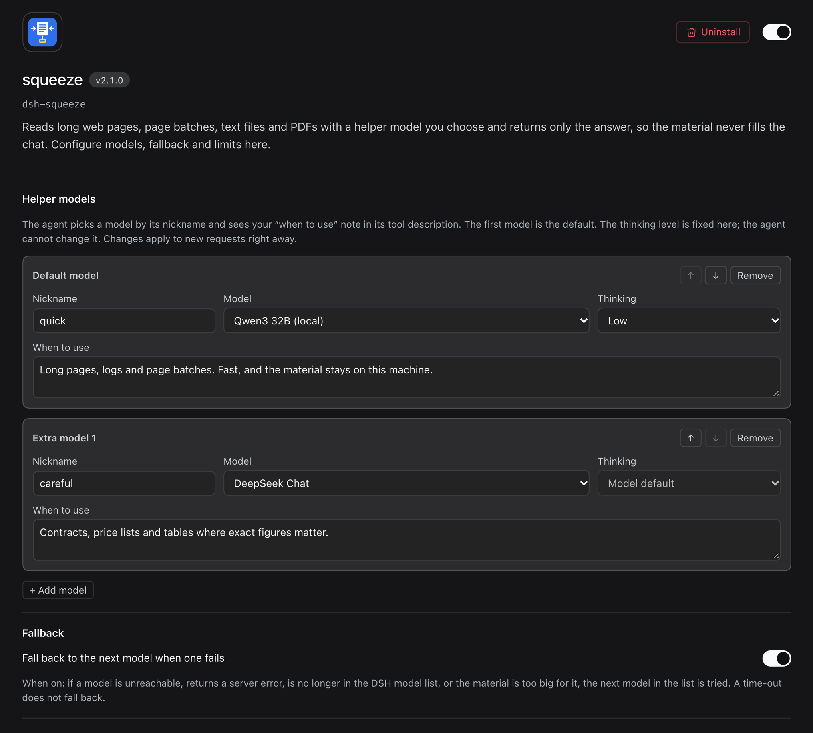

<p align="center"></p>

# squeeze — read long material without filling the chat

A plugin for [DeepSeek Harness](https://github.com/deepseek-ai/deepseek-harness) (DSH) that adds one tool, `squeeze`.

> 中文简介：`squeeze` 工具让 Agent 把长网页、多个网页、文本文件或 PDF 交给你选定的辅助模型阅读，只把答案带回对话，原文不占用上下文。注意：原文会发送给作答模型所属的提供方；开启回退（fallback）时，同一原文可能被发送给列表中另一提供方的模型。文件只通过 DSH 文件系统服务（ctx.fs）读取，被策略拒绝的路径一律拒绝（ACCESS DENIED）。

When an agent needs something from a long web page, a batch of pages, a big text file or a PDF, it calls `squeeze`
with a specific question. squeeze downloads or reads the material, hands it to a **helper model you choose**, and
returns **only the answer**. The material never enters the main conversation, so the agent's context stays small and
cheap.

Typical uses: pull figures out of a long report, find one section in a large log or code file, compare a few web
pages, summarise a transcript.

## Example

The agent asks about a 17,000-character government PDF. Only this comes back into the chat (a few hundred
characters instead of the whole document):

```
squeeze  url: https://tax.gov.ae/…/Cabinet Decision No. 75 of 2023 and amendments - For Publishing.pdf
         prompt: What penalty (AED) applies for failing to submit a corporate tax registration application on time?
                 Quote the item number.

Item 14 in the Table of Violations and Administrative Penalties: "Failure of the Taxable Person to submit a Tax
Registration application within the timeframe specified by the Authority …" — penalty AED 10,000.
(Footnote: added by Cabinet Decision No. 10 of 2024, effective 1 March 2024.)

squeeze: ok | model quick (Qwen Flash Next) | 6.9s | source 16,856 chars | thinking medium
```

(A real call from 3 Nov 2026, answered by a local model; the answer is shortened here.)

The status line tells the agent which model answered, how long it took and how big the source was. Failures say
what went wrong and what to do next (for example `squeeze SOURCE PROBLEM: … this PDF has no text layer (probably a
scan or photo) — it needs OCR`).

## Settings page



## Features

- **Models from your DSH model list** — pick a default model and up to two extra ones on the plugin's own settings
  page. Nothing to type twice: whatever providers and models DSH already knows are offered.
- **Nicknames and "when to use" notes** — give each model a short nickname (`quick`, `careful`, …) and a one-line
  note. The agent sees them in its tool description and picks a model by nickname.
- **Fixed thinking level per model** — you decide how hard each model thinks; the agent cannot change it.
- **Size limit follows the model** — each model's limit is worked out from its context window
  (default: the material may use 80% of it, the rest is left for thinking and the answer). The agent sees the limit
  per model.
- **Optional fallback** — when switched on, a model that is unreachable, returns a server error, has left the model
  list, or is too small for the material is skipped and the next model in your list is tried. The answer's status
  line says which model answered and why the others were skipped. Time-outs do not fall back.
- **Clear errors** — every failure starts with a kind the agent can act on (`REQUEST PROBLEM`, `SOURCE PROBLEM`,
  `TOO BIG`, `MODEL UNAVAILABLE`, `NO ANSWER`, `TIMED OUT`, `CANCELLED`, `ACCESS DENIED`) and ends with the next step.
- **Batches of pages** — up to 20 addresses per call (configurable), downloaded four at a time; dead pages are
  skipped and listed instead of failing the whole call.
- **PDFs** — PDF links and PDF files with a text layer are converted to text automatically when the free
  `pdftotext` program (poppler; `brew install poppler` on a Mac) is installed. Scanned PDFs are refused with
  advice to use OCR.
- **Sites with huge headers** — some government portals send more header data than Node's built-in downloader
  accepts (16 KB); squeeze retries those with a larger limit.
- **Short pages** — a page with almost no text (often a JavaScript-only or blocked page) is handed back to the agent
  as-is without a model call (or refused, if you prefer).
- **One call at a time per provider** — calls to the same provider queue, so a single local model is never
  flooded; calls to different providers (say a local box and a cloud model) do not wait for each other.
- No Python, no extra packages: the tool uses DSH's own model connections and logins.

## Install

Requires DSH 0.2.1-rc.5 or newer. For PDF support also install `pdftotext` (`brew install poppler` on a Mac).

**From the GitHub release** — ask the DSH agent:

> Install the bundle `https://github.com/q8atnight/dsh-squeeze/releases/download/v2.1.0/dsh-squeeze-2.1.0.tgz` with the plugin manager.

(It uses `plugin_manager` → `install_bundle` with that address. You can also download the `.tgz` file and give the
agent its path instead.)

**From a folder** — clone or unpack this repository somewhere permanent (for example `~/.dsh/plugins/dsh-squeeze`)
and ask the agent to install the bundle at that folder.

Then restart DSH if the plugin manager says a restart is needed, and open **Plugins → squeeze → Configure** to
choose your models.

Without any model chosen, squeeze uses the DSH default chat model.

## Settings

| Setting | Default | Meaning |
|---|---|---|
| Helper models | — | Default + up to 2 extra: model, nickname, thinking level, "when to use" note. The same model can be listed only once. |
| Fallback | off | Try the next model when one is down or too small. |
| Context fill (%) | 80 | Share of each model's context window the material may use. |
| Output budget (tokens) | 16,000 | Thinking + answer, capped at the model's own maximum. |
| Time limit per model call (s) | 600 | Longer calls are stopped and reported. |
| Time limit per page download (s) | 30 | |
| Web addresses per call | 20 | |
| Longest answer (characters) | 6,000 | Longer answers are cut at a line break and marked `ANSWER CUT`. |
| Minimum page length (characters) | 300 | Below this a single page is treated as "probably JavaScript-only or blocked". |
| Pages under the minimum length | hand over as-is | Or refuse with an error. |

Changes apply to the next tool call; open sessions see the new tool description from their next request.

## The tool (what the agent sees)

Parameters: `prompt` (required), and one source — `url`, `urls` (list) or `file` (path; `file_path` is accepted
too) — plus `model` (a nickname) when more than one model is set up.

The result is the answer followed by a status line, for example:

```
squeeze: ok | model careful (GLM-5.3-Flash) | 41.2s | source 152,300 chars | thinking high
```

## Limits

- Text, HTML and text PDFs only (PDFs need `pdftotext`). Convert Word or Excel files to text first; scans and
  photos need OCR.
- Pages that only render with JavaScript cannot be read — use a browser tool for those.
- Size limits are estimates (characters → tokens). If a model still reports "too long", the call is reported as
  `TOO BIG` (or falls back, if fallback is on).
- Answers come from a helper model: treat them as leads and check important figures against the source.

## Where your text goes (data flow)

- **The full source text leaves this machine for the helper model.** For every call, the converted text of the page(s)
  or file plus the agent's question is sent, through DSH's own model connection, to the **provider of the model that
  answers** — exactly as if you had pasted it into a chat with that model. With a cloud provider, the provider's own
  terms and retention apply. Only the answer comes back into the main conversation.
- **Fallback can send it to a different provider.** With fallback on, if the chosen model is unreachable, errors, has
  left the model list or is too small, the **same text is sent to the next model in your list**, which may belong to a
  different provider (for example a cloud model after a local one). The status line under the answer names the model
  that answered and lists the ones that were skipped. Keep fallback off, or list only models you trust with the
  material, if that matters to you.
- Web pages are downloaded by squeeze itself (from your machine, no proxy); nothing else is contacted. squeeze sends
  no telemetry and stores no material — PDFs are converted in a temporary folder that is deleted right after.

## File access and sandboxing

- squeeze reads files **only through DSH's filesystem service** (`ctx.fs`) — the same path resolution and the same
  service as the built-in `read` tool — so whatever filesystem/sandbox policy your DSH setup mounts applies to squeeze
  too. It never opens a model-supplied path with Node's own file functions.
- A refusal by that service is final: the call fails with `ACCESS DENIED`, nothing is sent to any model, and there is
  no fallback route. (`test/unit.mjs` has regression tests for this: denied at path resolution, denied at read time,
  denied PDF, and no filesystem service at all.)
- Note: DSH's shipped sandbox (`dsh-fs-sandbox`, 0.2.1) fences writes and edits only — "every mode permits reading" — so
  in a default setup squeeze can read the same files the `read` tool can, no more.
- `pdftotext` only ever receives squeeze's own temporary copy of the bytes the filesystem service returned.

## Files

- `index.js` — the tool (host side)
- `client.js` — the settings page
- `cordis.patch.yml` — switches the plugin on when the bundle is installed
- `locale/en.json`, `icon.svg` — name, description and icon shown on the Plugins page
- `assets/`, `screenshots.json` — README pictures and the screenshot list used by plugin storefronts
- `test/` — offline checks: `ELECTRON_RUN_AS_NODE=1 "<DSH app binary>" --import ./test/hooks.mjs test/unit.mjs`

## Changes

- **2.1.1** (6 Nov 2026) — files are read through DSH's filesystem service (`ctx.fs`) instead of Node's `fs`, so the
  host's filesystem policy applies; denials are reported as `ACCESS DENIED` (regression tests added); README documents
  where the source text is sent and that fallback may send it to another provider.
- **2.1.0** (3 Nov 2026) — PDF links and files are read (via `pdftotext`); sites with more than 16 KB of headers
  are read; batch pages download in parallel; downloads without a size header are capped too; over-long answers
  are cut at a line break with status `ANSWER CUT` (out-of-budget answers keep `ANSWER INCOMPLETE`); the queue is
  per provider instead of global.
- **2.0.0** — settings page, up to three models with nicknames, fallback, size limits from the context window.

## Licence

MIT — see `LICENSE`.
